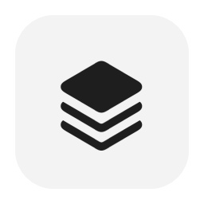

# KataLog

**Récupérez, classez et comprenez vos logs PX4 sur Mac.**

KataLog réunit les fichiers ULog de vos drones et AquaDrones dans une bibliothèque
locale. Importez un dossier, récupérez les logs depuis une GCS Drotek ou branchez
un contrôleur PX4 en USB, puis consultez les vols, messages, trajectoires et rapports.

**macOS 15 ou ultérieur · Apple Silicon et Intel · GPL-3.0-only**

[**Télécharger KataLog**](https://github.com/mehdi7129/KataLog/releases/latest) ·
[Guide utilisateur](docs/README.md) · [Nouveautés](CHANGELOG.md) ·
[Contribuer](CONTRIBUTING.md)

## Installer

Dans ** → À propos de ce Mac**, repérez la puce ou le processeur, puis choisissez
le DMG correspondant sur la [page de release](https://github.com/mehdi7129/KataLog/releases/latest).

| Votre Mac | Fichier à télécharger |
| --- | --- |
| Puce Apple M1, M2, M3, M4… | `KataLog-VERSION-macOS-arm64.dmg` |
| Processeur Intel | `KataLog-VERSION-macOS-x86_64.dmg` |

Ouvrez le DMG, glissez **KataLog.app** dans **Applications**, éjectez le disque,
puis lancez l’app. Les distributions stables sont signées Developer ID et
notarisées par Apple. Le moteur Python est embarqué : aucun outil de développement
ni installation de Python n’est nécessaire. Chaque version fonctionne nativement
sur son architecture.

La première ouverture crée une bibliothèque vide. Remplacer l’app lors d’une mise
à jour conserve les analyses, clients, notes, favoris et réglages existants.

## Récupérer les logs

### Depuis un dossier

Cliquez sur **Importer**, choisissez un dossier contenant des `.ulg`, puis
**Référencer les fichiers** ou **Copier vers mes archives**. KataLog parcourt les
sous-dossiers et reconnaît les fichiers déjà analysés. Conservez les originaux
ou archivez-les pour pouvoir recalculer leurs analyses plus tard.

### Depuis une GCS Drotek

Dans **Collecte GCS**, connectez votre GCS et choisissez le dossier de destination.
Utilisez **Tout collecter**, ou ouvrez **Voir les logs** pour sélectionner les
fichiers de chaque drone. Vous pouvez consulter un autre appareil et ajouter ses
logs à la file pendant un téléchargement. Chaque demande conserve son appareil,
son client destinataire et son dossier.

Les transferts peuvent avancer sur plusieurs drones, avec un fichier à la fois
par drone. **Mettre en pause** termine les fichiers actifs ; **Arrêter** interrompt
la collecte locale. Les fichiers vérifiés peuvent être analysés automatiquement.

[Collecte réseau, reprise et limites](docs/GCS-COLLECTION.md)

### En USB direct

Dans la section **USB direct** de la collecte :

1. Branchez le contrôleur PX4 désarmé avec un câble USB de données. Fermez sa
   connexion dans QGroundControl pour libérer le port serial.
2. Actualisez les ports, choisissez le port du contrôleur, puis **Lire les logs**.
3. Cochez les fichiers et cliquez sur **Ajouter à la file**.

La copie passe directement du contrôleur au Mac, sans la GCS ni son réseau.
Les originaux restent sur la carte SD. Le protocole utilisé est le téléchargement
de logs MAVLink ; le firmware doit l’exposer sur le port USB choisi.

Pour préparer plusieurs appareils avec un seul câble, mettez la file en pause,
branchez chaque appareil et ajoutez ses logs. Rebranchez ensuite un appareil,
lisez son inventaire et choisissez **Reprendre cet appareil**. Les demandes des
autres appareils restent en attente. Une coupure conserve la demande ; la reprise
USB recommence le fichier incomplet.

Le transfert est vérifié par identité de contrôleur, métadonnées, couverture des
octets, signature ULog et empreinte locale SHA-256. Les essais automatisés couvrent
les trames MAVLink 1/2, pertes et déconnexions sur un port serial simulé.
**Le débit et la compatibilité avec le firmware Aqua installé restent à confirmer
sur matériel réel.** L’USB supprime la dépendance au réseau ; il ne garantit pas
à lui seul un téléchargement plus rapide.

[Guide USB et dépannage](docs/USB-COLLECTION.md)

## Explorer et partager

| Vue ou fonction | Ce qu’elle permet |
| --- | --- |
| Historique et clients | Retrouver un log, filtrer les appareils et organiser les analyses par client. |
| Fiches de log | Lire la synthèse, les messages, les notes et les courbes batterie, GNSS et EKF. |
| Alertes | Filtrer les messages et consulter leur sens, les vérifications proposées, les limites et les sources. |
| Carte | Suivre les trajectoires et rechercher par lieu, coordonnées ou rayon. |
| Comparaison | Comparer le firmware et les paramètres de deux logs d’un même contrôleur. |
| Favoris | Enregistrer les filtres utilisés régulièrement. |
| Rapports | Exporter un HTML autonome, un JSON ou imprimer le rapport en PDF. |
| Conservation | Archiver les sources, sauvegarder et restaurer la bibliothèque, réassocier des fichiers déplacés. |

Les thèmes clair, sombre et système sont disponibles. Le **mode avancé** donne
accès aux événements, paramètres, topics et mesures détaillées.

Les explications d’alertes distinguent les définitions documentées, les
interprétations et les codes encore inconnus. Une observation dans un log ne
suffit pas à établir une cause de panne. La couverture dépend des données
présentes et, pour les événements binaires, du dictionnaire exact du firmware.

[Guide complet](docs/README.md) · [Catalogue des alertes](research/alerts/README.md)

## Mettre à jour

Ouvrez **Réglages → Mises à jour → Rechercher une mise à jour**, puis choisissez
**Installer et redémarrer**. Terminez les imports, collectes et exports en cours.
Chaque architecture reçoit son propre flux signé. Vous pouvez aussi remplacer
manuellement l’app avec le DMG correspondant à votre Mac.

[Conservation des données et mises à jour](docs/UPDATING.md)

## Données et confidentialité

La bibliothèque et ses classements sont stockés sur le Mac. KataLog lit les ULogs
sources sans les modifier et ne pilote pas les appareils. La collecte contacte
la GCS configurée ou le port USB choisi. Apple Maps et la recherche d’adresses
utilisent le réseau ; les mises à jour sont hébergées sur GitHub.

Un rapport peut contenir identifiants, positions GPS, chemins et notes. Le mode
partage retire les notes personnelles, mais n’anonymise pas toutes les autres
données. Vérifiez le périmètre et le contenu avant de transmettre un fichier.

Ce dépôt contient des fixtures synthétiques. Les logs, bibliothèques et captures
de flotte réels restent hors du dépôt public.

[Import et conservation](docs/IMPORT-CONTRACT.md) ·
[Diagnostic local](docs/DIAGNOSTICS.md)

## Développer

Prérequis : macOS 15+, Xcode avec Swift 6, Python 3.13 ; Node.js 22 pour les tests
HTML. Swift Package Manager gère les dépendances Swift. Les dépendances Python
sont épinglées avec leurs hashes.

```sh
bash .paradev/setup.sh
source .venv/bin/activate
python tools/run-python-tests.py --summary reports/python-tests.json
python tools/run-swift-tests.py --summary reports/swift-tests.json
node --test Tests/test_report_interaction.cjs
```

Paradev exécute ce setup à la création du workspace. Aucun serveur de développement,
Docker ou service externe n’est nécessaire. Les builds de distribution sont
natifs à l’architecture de la machine qui les compile.

[Contribution et builds](CONTRIBUTING.md) ·
[Banc USB sans matériel](docs/USB-COLLECTION.md#banc-sans-matériel) ·
[Signature et distribution](docs/RELEASING.md)

## Licence

KataLog est distribué sous **GPL-3.0-only**, sans garantie.

[Licence](LICENSE) · [Licences des dépendances](docs/DEPENDENCIES-LICENSES.md)
