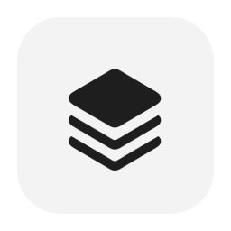

# KataLog

**Vos logs PX4, organisés et lisibles sur Mac.**

KataLog rassemble les fichiers ULog dans une bibliothèque locale.
Retrouvez un vol, comprenez ses messages, explorez sa trajectoire et
partagez un rapport depuis une app macOS native.

**macOS 15 ou ultérieur · Apple Silicon · GPL-3.0-only**

[**Télécharger KataLog**](https://github.com/mehdi7129/KataLog/releases/latest) ·
[Guide utilisateur](docs/README.md) ·
[Nouveautés](CHANGELOG.md) ·
[Contribuer](CONTRIBUTING.md)

## Installation

1. Télécharger le DMG depuis la page de release.
2. L’ouvrir et glisser **KataLog.app** dans **Applications**.
3. Éjecter le DMG, puis lancer KataLog depuis Applications.

La distribution stable est signée Developer ID et notarisée par Apple.
Le moteur d’analyse est embarqué : aucune installation séparée de Python
ou de Homebrew n’est nécessaire.

Une première installation crée une bibliothèque vide. Le remplacement
de l’app conserve la bibliothèque et les réglages existants.

## Prise en main

1. Cliquer sur **Importer** et choisir un dossier de fichiers `.ulg`.
2. Choisir **Référencer les fichiers** ou **Copier vers mes archives**.
3. Parcourir **Historique**, **Carte**, **Drones** et **Alertes**.
4. Ouvrir un log pour consulter ses messages, sa trajectoire et ses courbes.
5. Dans **Rapports**, choisir le périmètre à exporter.

Le classement par client est facultatif. Les filtres favoris permettent
de retrouver rapidement une sélection.

[Consulter le guide](docs/README.md)

## Fonctions

| Fonction | Utilisation |
| --- | --- |
| Bibliothèque | Import récursif, détection des doublons, classement local et recherche dans l’historique. |
| Alertes | Messages filtrables, familles personnalisables et explications avec vérifications, limites et sources. |
| Fiches de log | Synthèse, notes personnelles, messages et courbes batterie, GNSS et EKF. |
| Carte | Trajectoires sur Apple Maps et recherche par lieu, coordonnées ou rayon. |
| Comparaison | Firmware et différences de paramètres entre deux logs du même contrôleur. |
| Collecte GCS | Récupération des logs depuis une GCS Drotek, avec progression, pause et reprise. |
| Rapports | HTML autonome, export JSON et impression en PDF depuis le rapport. |
| Conservation | Archivage vérifié, sauvegarde, restauration et réassociation des fichiers sources. |

Les thèmes clair, sombre et système sont disponibles.
Le **mode avancé** donne accès aux événements, paramètres, topics,
mesures détaillées et informations de couverture.

### Comprendre les messages

Les explications distinguent les définitions documentées,
les interprétations du texte et les codes dont le sens reste inconnu.
Le sens principal apparaît d’abord ; les vérifications et références
se consultent à la demande.

Une alerte décrit une observation, pas une cause de panne certaine.
Les mesures disponibles dépendent du contenu du log. La traduction
des événements binaires exige le dictionnaire exact du firmware.

[Catalogue et méthode](research/alerts/README.md)

## Mises à jour

Ouvrir **Réglages → Mises à jour → Rechercher une mise à jour**,
puis choisir **Installer et redémarrer**.
Terminer les imports, collectes et exports avant l’installation.

L’installation manuelle reste possible en remplaçant l’app depuis le DMG.

[Procédure de mise à jour](docs/UPDATING.md)

## Données et confidentialité

La bibliothèque, les classements, les favoris et les notes sont stockés
localement. Les fichiers ULog sources sont lus sans modification.
Conserver les originaux ou utiliser l’archivage pour pouvoir recalculer
leurs analyses.

Apple Maps et la recherche d’adresses utilisent le réseau.
La collecte contacte la GCS configurée ; les mises à jour utilisent
le flux signé hébergé sur GitHub.

Les rapports privés peuvent contenir identifiants, coordonnées,
chemins et notes personnelles. Le mode partage retire les notes.
Vérifier le périmètre et le contenu avant de transmettre un rapport.

Le dépôt contient des fixtures synthétiques. Les logs, bibliothèques
et captures contenant des données réelles restent hors du dépôt public.

[Import et conservation](docs/IMPORT-CONTRACT.md) ·
[Diagnostic local](docs/DIAGNOSTICS.md)

## Développer et contribuer

Le développement utilise Swift 6, Python 3.13 et Node.js.
Le guide de contribution décrit la préparation de l’environnement,
les builds locaux, les tests et les pull requests.

[Contribuer](CONTRIBUTING.md) ·
[Documentation technique](docs/README.md#développement-et-références) ·
[Distribution et qualification](docs/RELEASING.md)

## Licence

KataLog est distribué sous **GPL-3.0-only**, sans garantie.

[Licence](LICENSE) · [Licences des dépendances](docs/DEPENDENCIES-LICENSES.md)
